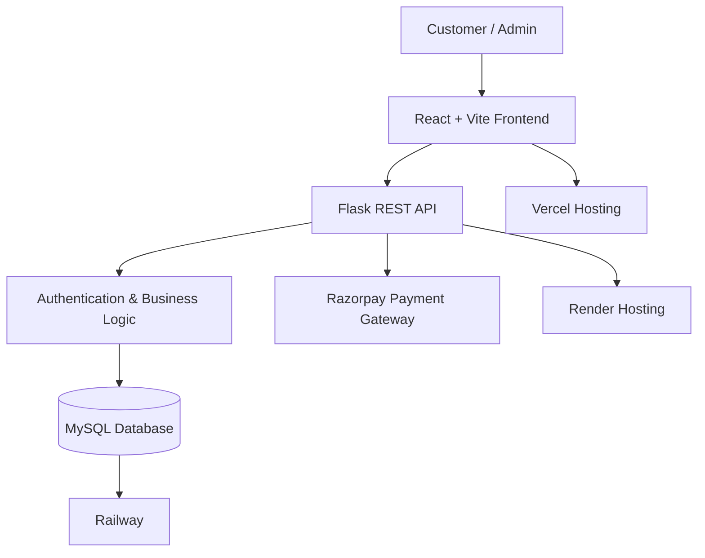
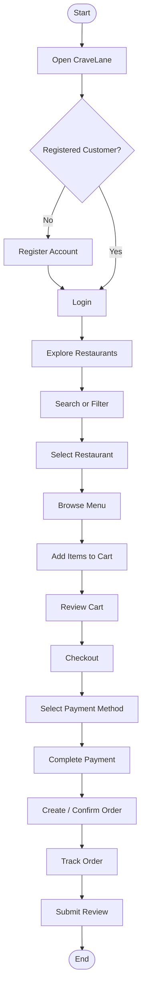
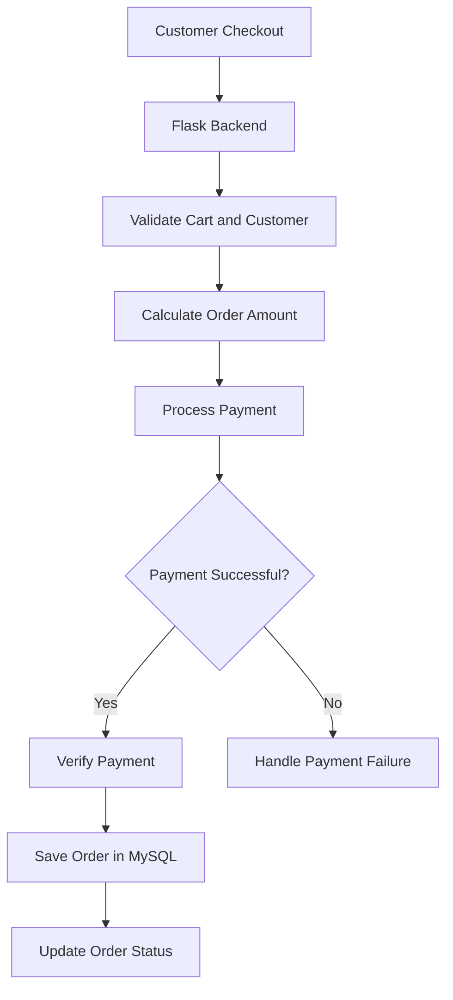
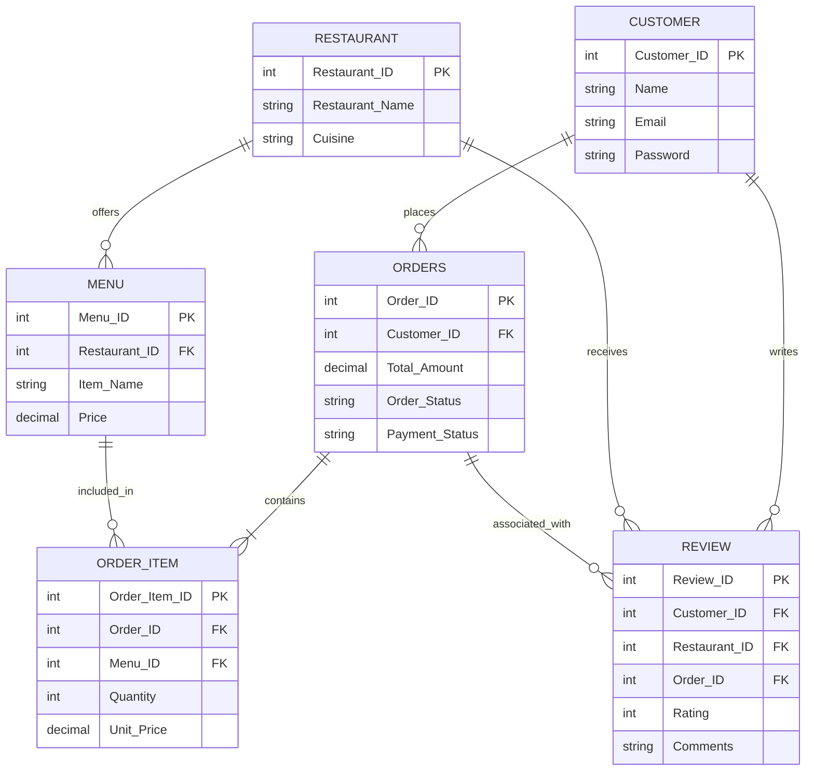
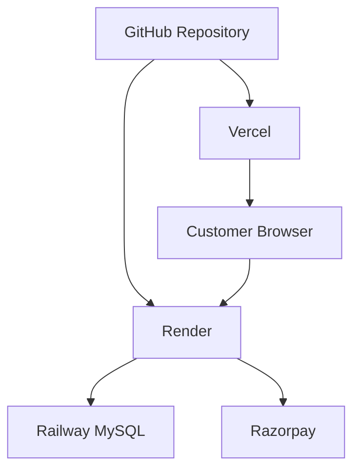
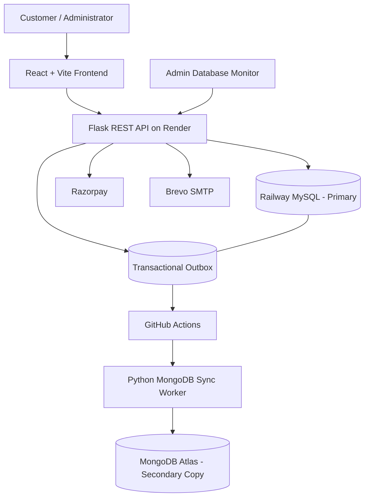

🍽️ CraveLane – Online Food Ordering System
Discover. Order. Enjoy.

CraveLane is a full-stack online food ordering platform that allows customers to explore restaurants, browse menus, place food orders, make online payments and track their orders through a simple and user-friendly interface.

The application provides restaurant discovery, customer account management, cart functionality, wishlist management, order processing, ratings and reviews, and an administrative dashboard.
🌐 Live Application
- Frontend: https://cravelane.vercel.app
- Backend: https://cravelane-backend-m8tn.onrender.com
📌 Table of Contents
1. About the Project
2. Key Features
3. Technology Stack
4. System Architecture
5. Application Workflow
6. Database Design
7. Project Structure
8. Getting Started
9. Environment Configuration
10. API Overview
11. Deployment
12. Future Enhancements
1. About the Project
CraveLane was developed to provide a convenient and interactive online food ordering experience.

Customers can discover available restaurants, search for specific dishes or cuisines, explore restaurant menus, add items to their cart, manage their wishlist and complete orders using an integrated payment gateway.

The platform also includes an administrative interface for managing restaurant operations and monitoring customer orders.

The project follows a full-stack architecture, separating the frontend, backend and database layers to improve maintainability and scalability.
2. Key Features
👤 Customer Management
- Customer registration and login.
- Secure password hashing.
- Customer profile management.
- Authentication and protected routes.
🍴 Restaurant Discovery
- Browse available restaurants.
- Search by restaurant name, dish, cuisine and location.
- Filter restaurants by cuisine.
- Explore restaurant-specific menus.
- View food descriptions, prices and availability.
🛒 Cart and Wishlist
- Add food items to the cart.
- Increase or decrease item quantities.
- Remove individual items.
- View order subtotal.
- Add and remove restaurants or items from the wishlist.
📦 Order Management
- Place food orders.
- View previous orders.
- Track order status.
- Manage delivery information.
- View order details and ordered items.
💳 Online Payments
- Razorpay payment gateway integration.
- Test Mode payment processing.
- Backend payment verification.
⭐ Ratings and Reviews
- Submit restaurant ratings.
- Add customer reviews.
- View restaurant ratings and reviews.
- Edit or delete eligible reviews.
🛠️ Admin Dashboard
- Administrative authentication.
- Dashboard statistics.
- Restaurant and order management.
- Customer and order monitoring.
- Order status updates.
3. Technology Stack
Layer	Technologies
Frontend	React.js, Vite
Programming Language	JavaScript
Styling	CSS
Backend	Python, Flask
Database	MySQL
Database Hosting	Railway
Backend Hosting	Render
Frontend Hosting	Vercel
Payment Gateway	Razorpay
Version Control	Git, GitHub

4. System Architecture
CraveLane follows a three-tier architecture consisting of the presentation layer, application layer and database layer.
Architecture Diagram

Architecture Components
Presentation Layer – React + Vite

Provides the user interface for customers and administrators. It handles user interactions, navigation, search, cart operations and API communication.

Application Layer – Flask

Handles API requests, authentication, business logic, database operations, order processing and payment verification.

Data Layer – MySQL

Stores customer information, restaurant details, menu items, orders, order items, payments and reviews.
5. Application Workflow
Customer Workflow

Order Processing Workflow

6. Database Design
CraveLane uses a relational MySQL database hosted on Railway.
Main Database Tables
Table	Purpose
customer	Stores customer account details
restaurant	Stores restaurant information
menu	Stores restaurant menu items
orders	Stores customer order information
order_item	Stores individual items belonging to an order
review	Stores restaurant ratings and customer reviews

Entity Relationship Overview

Note: This diagram represents the principal relationships. The actual database schema is defined by the SQL table definitions.
7. Project Structure
CraveLane/
│
├── backend/
│   ├── app.py
│   ├── requirements.txt
│   ├── .env
│   │
│   └── database/
│       ├── __init__.py
│       └── mysql_db.py
│
├── frontend/
│   ├── public/
│   │
│   ├── src/
│   │   ├── components/
│   │   │   ├── Navbar.jsx
│   │   │   ├── LandingPage.jsx
│   │   │   ├── Login.jsx
│   │   │   ├── Register.jsx
│   │   │   └── RestaurantReviews.jsx
│   │   │
│   │   ├── pages/
│   │   │   ├── RestaurantsPage.jsx
│   │   │   ├── MenuPage.jsx
│   │   │   ├── CartPage.jsx
│   │   │   ├── WishlistPage.jsx
│   │   │   └── AboutPage.jsx
│   │   │
│   │   ├── App.jsx
│   │   ├── main.jsx
│   │   ├── config.js
│   │   └── index.css
│   │
│   ├── index.html
│   ├── package.json
│   └── vercel.json
│
└── README.md
The structure is an overview of the main files; additional components and styles may exist in the repository.
8. Getting Started
Follow these steps to run CraveLane locally.
Prerequisites
Install the following:
- Python 3.10 or later
- Node.js and npm
- MySQL Server
- Git
- Visual Studio Code (recommended)
Step 1: Clone the Repository
git clone <YOUR_GITHUB_REPOSITORY_URL>
cd CraveLane
Step 2: Set Up the Backend
Navigate to the backend directory:
cd backend
Create and activate a virtual environment:
python -m venv venv
Windows:
venv\Scripts\activate
Install dependencies:
pip install -r requirements.txt
Create a .env file inside the backend directory and configure the local database credentials.

Start the Flask server:
python app.py
The backend will run at:
http://127.0.0.1:5000
Step 3: Set Up the Frontend
Open another terminal:
cd frontend
Install dependencies:
npm install
Create .env.development inside the frontend directory:
VITE_API_URL=http://localhost:5000
Start the Vite development server:
npm run dev
Open:
http://localhost:5173
9. Environment Configuration
The application uses environment variables to configure its database connection and external services.
Backend Environment Variables
Example configuration:
USE_CLOUD_DB=false

DB_HOST=localhost
DB_PORT=3305
DB_USER=root
DB_PASSWORD=your_mysql_password
DB_NAME=foodorderingdb

CRAVELANE_SECRET_KEY=your_secret_key

RAZORPAY_KEY_ID=your_razorpay_key
RAZORPAY_KEY_SECRET=your_razorpay_secret

MAIL_SERVER=smtp-relay.brevo.com
MAIL_PORT=587
MAIL_USERNAME=your_smtp_username
MAIL_PASSWORD=your_smtp_password
MAIL_DEFAULT_SENDER=your_verified_sender_email
Use the actual values configured for your environment. Do not commit secrets to GitHub.
Frontend Environment Variables
Local development:
VITE_API_URL=http://localhost:5000
Production:
VITE_API_URL=https://cravelane-backend-m8tn.onrender.com
10. API Overview
The Flask backend exposes REST API endpoints for the application's operations.
Endpoint	Method	Purpose
/register	POST	Register a customer
/login	POST	Authenticate a customer
/restaurants	GET	Retrieve restaurants
/restaurants/<id>/menu	GET	Retrieve restaurant menu
/profile/<id>	GET	Retrieve customer profile
/orders	POST	Create an order
/my-reviews	GET	Retrieve customer reviews
/reviews	POST	Submit a review
/restaurants/<id>/reviews	GET	Retrieve restaurant reviews

Authentication, request payloads and response structures vary by endpoint. Refer to the Flask implementation for the complete API contract.
11. Deployment
CraveLane is deployed using cloud hosting services.
Component	Platform
Frontend	Vercel
Backend	Render
MySQL Database	Railway
Payment Gateway	Razorpay Test Mode

Deployment Architecture

The frontend communicates with the Flask backend through HTTP API requests. The backend connects to Railway MySQL using environment variables.
12. Future Enhancements
The following improvements are planned or under consideration:
- MongoDB Integration: Add MongoDB Atlas as a second database option alongside MySQL.
- Dual Database Management: Provide an admin-controlled database selection mechanism.
- Database Migration: Explore controlled data migration between MySQL and MongoDB.
- Order Tracking: Improve real-time order status visibility.
- Analytics Dashboard: Add advanced sales, restaurant and customer analytics.
- Recommendation System: Introduce personalized food recommendations.
- Performance Optimization: Improve API response times and application scalability.
👩‍💻 Project
CraveLane – Online Food Ordering System

Developed as a full-stack academic software project.

Technologies: React, Vite, Python, Flask, MySQL, Railway, Render, Vercel and Razorpay.
License
This project is developed for academic and learning purposes. Add an appropriate open-source license before permitting reuse or redistribution.
📸 Application Screenshots
Home Page

Restaurant Listings

Restaurant Menu

Shopping Cart

Checkout

Order History

Wishlist

Ratings and Reviews

Admin Dashboard

Order Management

Restaurant Management

🚀 CraveLane Dual-Database Integration (Current Implementation)
Implementation update: The original sections above document the initial MySQL-based version of CraveLane. The following sections extend that documentation with the completed MySQL–MongoDB integration. Earlier descriptions of MongoDB as a future enhancement refer to the project's initial development stage; MongoDB is now integrated as a synchronized secondary database.

13. Updated Technology Stack
Layer	Technology
Frontend	React.js, Vite, JavaScript, CSS
Backend	Python, Flask, REST APIs
Primary database	MySQL
Primary database hosting	Railway
Secondary database	MongoDB Atlas
MongoDB driver	PyMongo
Synchronization pattern	Transactional Outbox
Synchronization worker	Python
Automation and scheduling	GitHub Actions
Frontend hosting	Vercel
Backend hosting	Render
Payments	Razorpay Test Mode
Email	Brevo SMTP
Version control	Git, GitHub

14. Dual-Database Architecture
CraveLane uses a dual-database architecture in which MySQL remains the primary database and MongoDB Atlas maintains a synchronized document-oriented copy.
Architecture Diagram

Roles of the databases
MySQL – Primary database
- Acts as the source of truth for application transactions.
- Stores customers, restaurants, menu items, orders, order items, reviews and synchronization events.
- Enforces relational constraints and relationships.
- Receives application writes first.
MongoDB Atlas – Secondary database
- Stores synchronized copies in document collections.
- Uses document structures suited to MongoDB queries.
- Stores order items embedded within their corresponding order documents.
- Does not replace MySQL as the application's primary write database.
Important: The current design is one-way synchronization from MySQL to MongoDB. It is not active-active, bidirectional replication, or a mechanism that writes to both databases at exactly the same instant.
15. Transactional Outbox and Automatic Synchronization
CraveLane uses the Transactional Outbox Pattern to record database changes that need to be reflected in MongoDB.
Why the Outbox Pattern?
Writing to MySQL and MongoDB independently can create partial updates. For example, the MySQL update might succeed while the MongoDB update fails.

The outbox pattern records the business-data change and its synchronization event in the same MySQL transaction. The MongoDB update is then performed asynchronously by a separate worker.
Synchronization flow
1. A customer or administrator performs an operation through the application.
2. Flask validates the request and updates the relevant MySQL record.
3. Flask inserts a corresponding event into sync_outbox in the same MySQL transaction.
4. The MySQL transaction commits.
5. GitHub Actions starts the Python synchronization worker on its configured schedule.
6. The worker claims pending events from sync_outbox.
7. The worker reads the latest corresponding MySQL record and prepares a MongoDB document.
8. The worker performs an upsert or delete operation in the relevant MongoDB collection.
9. After successful synchronization, the event is marked processed.
10. If synchronization fails, the worker applies its retry policy and records the error/status.
Automatic schedule
The GitHub Actions workflow is configured with:
on:
  schedule:
    - cron: "*/15 * * * *"
  workflow_dispatch:
- schedule requests an automatic run every 15 minutes.
- workflow_dispatch allows an administrator or developer to start a run manually when needed.
- Manual execution is optional; normal synchronization is scheduled.
- GitHub may delay scheduled workflows, so the interval is a target schedule rather than a hard real-time guarantee.
Event status meanings
Status	Meaning
pending	Waiting to be synchronized
processing	Claimed by the worker and currently being processed
processed	Successfully synchronized to MongoDB
failed	Retry limit reached without successful synchronization

Outbox table
The sync_outbox table tracks:
- Event_ID – unique event identifier.
- Entity_Type – type of record, such as customer, restaurant, menu, orders or review.
- Entity_ID – identifier of the affected record.
- Operation – upsert or delete.
- Status – current processing status.
- Created_At – event creation timestamp.
- Processed_At – successful processing timestamp.
- Attempts – number of processing attempts.
- Last_Error – most recent recorded error, if any.
- Locked_At – time at which an event was claimed for processing.
Synchronization consistency
The application follows eventual consistency:
- MySQL is updated first.
- MongoDB is updated after the worker processes the outbox event.
- A short delay between the two databases is expected.
- If an event is pending or being retried, the MongoDB copy may temporarily be behind MySQL.
This is periodic asynchronous synchronization, not instantaneous or synchronous replication.
16. MySQL-to-MongoDB Collection Mapping
MySQL table(s)	MongoDB collection	Document representation
customer	customers	One document per customer
restaurant	restaurants	One document per restaurant
menu	menu_items	One document per menu item
orders + order_item	orders	One order document with embedded items
review	reviews	One document per review

Document identifiers and data handling
- Existing MySQL record identifiers are preserved in MongoDB documents.
- The migration and synchronization processes use stable identifiers to support repeatable upserts.
- Order items are embedded in the matching order document.
- Decimal-valued fields are converted to BSON Decimal128 where appropriate.
- Customer password fields are excluded from MongoDB documents.
- The migration uses replacement/upsert behavior so that rerunning it updates matching documents rather than creating duplicate documents for the same identifier.
17. Initial Data Migration
The initial migration was performed using:
python -m scripts.migrate_mysql_to_mongo
The script supports a preview/dry-run mode. To apply the migration:
python -m scripts.migrate_mysql_to_mongo --apply
The successful initial migration reported:
Entity	MySQL records	MongoDB documents
Customers	4	4
Restaurants	4	4
Menu items	10	10
Orders	28	28
Reviews	0	0
Total top-level documents	46	46

The 29 order_item records were embedded within the 28 order documents. They are not counted as separate top-level MongoDB documents.

These figures represent the initial migration snapshot. Current counts can change as customers, restaurants, menu items, orders and reviews are added, modified or deleted.
18. Admin Database and Synchronization Monitoring
The administrator dashboard includes a database monitoring section.
Monitoring capabilities
- MySQL connection status.
- MongoDB connection status.
- Database selector to inspect MySQL or MongoDB record counts.
- Counts for customers, restaurants, menu items, orders and reviews.
- Synchronization queue counts for pending, processing, processed and failed events.
- Recent synchronization event history.
- Manual GitHub Actions workflow trigger.
Manual trigger and automatic execution
The manual trigger is provided for administrative testing or immediate synchronization requests. It is not required for routine synchronization because the GitHub Actions schedule runs automatically.

The Flask backend sends the GitHub workflow-dispatch request. The GitHub token is stored as a backend environment variable and is not placed in frontend code.

A successful dispatch response means GitHub accepted the workflow request. The workflow run itself must still complete successfully for the events to be confirmed as synchronized.
19. Verifying Database Synchronization
The following checks can be used to verify the current state of both databases.
MySQL record counts
Run in MySQL Workbench:
SELECT 'customers' AS entity, COUNT(*) AS total FROM customer
UNION ALL
SELECT 'restaurants', COUNT(*) FROM restaurant
UNION ALL
SELECT 'menu_items', COUNT(*) FROM menu
UNION ALL
SELECT 'orders', COUNT(*) FROM orders
UNION ALL
SELECT 'reviews', COUNT(*) FROM review;
MySQL outbox status counts
SELECT Status, COUNT(*) AS total
FROM sync_outbox
GROUP BY Status;
For a caught-up queue, there should be no pending, processing or failed events. A new event may temporarily appear as pending or processing while a scheduled run is underway.
Recent synchronization events
SELECT
    Event_ID,
    Entity_Type,
    Entity_ID,
    Operation,
    Status,
    Attempts,
    Created_At,
    Processed_At,
    Last_Error
FROM sync_outbox
ORDER BY Event_ID DESC
LIMIT 20;
MongoDB collection counts
Run in MongoDB Atlas Data Explorer or a MongoDB shell:
db.customers.countDocuments({})
db.restaurants.countDocuments({})
db.menu_items.countDocuments({})
db.orders.countDocuments({})
db.reviews.countDocuments({})
What constitutes a successful verification?
1. Compare the corresponding MySQL and MongoDB counts.
2. Compare individual documents using their preserved record identifiers.
3. Inspect important fields such as customer details, restaurant addresses, menu prices and order statuses.
4. Confirm that the relevant outbox events are marked processed.
5. Check that Last_Error is empty for successfully processed events.
Matching record counts alone do not prove that every field is identical. Individual record checks provide stronger verification.

Changes made directly in MySQL Workbench do not automatically create outbox events. Normal application changes must pass through the Flask operations that enqueue synchronization events, or an appropriate event must be created separately.
20. Updated Deployment Architecture
Component	Platform	Responsibility
React frontend	Vercel	Customer and administrator interface
Flask backend	Render	REST APIs and application logic
Primary database	Railway MySQL	Source of truth and outbox
Secondary database	MongoDB Atlas	Synchronized document copy
Synchronization automation	GitHub Actions	Scheduled worker execution
Payment gateway	Razorpay Test Mode	Payment processing
Email service	Brevo SMTP	Email delivery

Live application
- Frontend: https://cravelane.vercel.app
- Backend: https://cravelane-backend-m8tn.onrender.com
- GitHub repository: https://github.com/Abinayaa1006/CraveLane
GitHub Actions configuration
The repository workflow is located at:
.github/
└── workflows/
    └── mongo-sync.yml
The workflow uses repository secrets for database and MongoDB connection configuration. The backend uses environment variables for the GitHub workflow-dispatch token and repository configuration.

Never commit .env files, database passwords, MongoDB connection strings or GitHub access tokens.
21. Updated Testing and Verification
The following integration checks have been performed during development:
1. Initial Railway MySQL-to-MongoDB Atlas migration.
2. MongoDB Atlas connectivity from the local environment.
3. Restaurant description update synchronization.
4. Restaurant address update synchronization.
5. MySQL transactional outbox event generation.
6. Successful event processing and status updates.
7. GitHub Actions manual workflow execution.
8. GitHub Actions workflow dispatch through the administrator dashboard.
9. Admin database monitoring and record-count display.
10. Successful GitHub Actions workflow runs after manual dispatch from the admin dashboard.
The verified restaurant updates appeared in MongoDB Atlas, and corresponding outbox events were marked processed.

Testing scope note: The above confirms the tested migration and restaurant synchronization flows. Each other entity and operation (customer, menu, order, review, and deletion) should also be tested before claiming complete end-to-end coverage for every application operation.
22. Security and Operational Considerations
- MySQL remains the primary source of truth.
- MongoDB is a secondary synchronized copy, not a second independent write destination.
- Customer passwords are excluded from the MongoDB synchronization documents.
- Database credentials and API tokens are stored in environment variables or hosting secrets.
- The GitHub Actions token is used by the Flask backend for workflow dispatch and must never be exposed to the React frontend.
- The admin monitoring and trigger endpoints must remain protected by administrator authentication.
- Failed events should be monitored and investigated.
- Scheduled GitHub Actions execution is subject to GitHub's scheduling availability and possible delays.
- The synchronization worker should be monitored so that stale processing events and repeated failures can be investigated.
23. Updated Future Enhancements
The following are possible future improvements beyond the current implementation:
- Real-time or lower-latency synchronization.
- Automated data reconciliation and field-level comparison.
- Notifications for failed synchronization events.
- More detailed audit logs and synchronization metrics.
- Advanced sales and customer analytics.
- Personalized food recommendation systems.
- Improved recovery and operational alerting.
The original project sections above are retained as the documentation of the initial application. The dual-database sections in this update describe the current MySQL-primary, MongoDB-secondary implementation.
