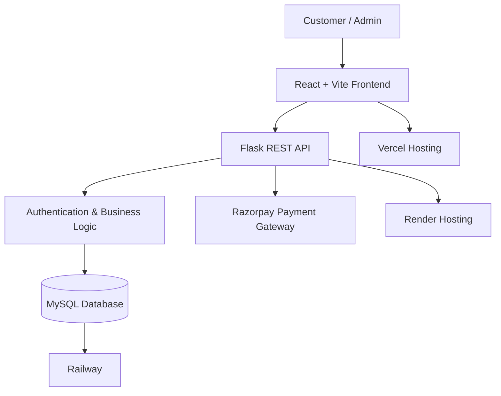
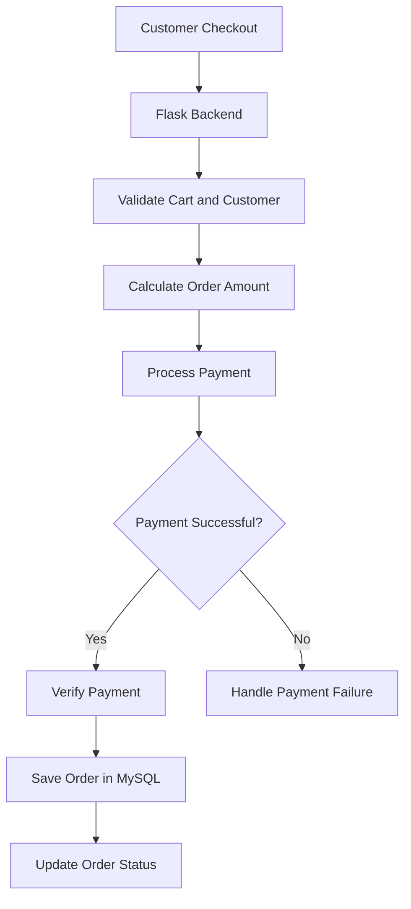
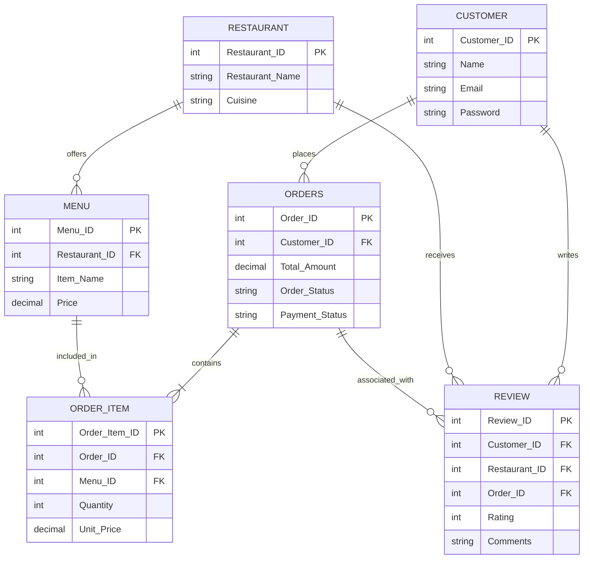
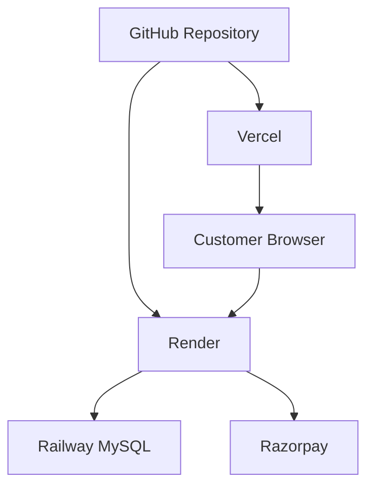

# 🍽️ CraveLane – Online Food Ordering System

**Discover. Order. Enjoy.**

CraveLane is a full-stack online food ordering platform that allows customers to explore restaurants, browse menus, place food orders, make online payments and track their orders through a simple and user-friendly interface.

The application provides restaurant discovery, customer account management, cart functionality, wishlist management, order processing, ratings and reviews, and an administrative dashboard.

---

## 🌐 Live Application

- **Frontend:** https://cravelane.vercel.app
- **Backend:** https://cravelane-backend-m8tn.onrender.com

---

## 📌 Table of Contents

1. About the Project
2. Key Features
3. Technology Stack
4. System Architecture
5. Application Workflow
6. Database Design
7. Project Structure
8. Getting Started
9. Environment Configuration
10. API Overview
11. Deployment
12. Future Enhancements

---

## 1. About the Project

CraveLane was developed to provide a convenient and interactive online food ordering experience.

Customers can discover available restaurants, search for specific dishes or cuisines, explore restaurant menus, add items to their cart, manage their wishlist and complete orders using an integrated payment gateway.

The platform also includes an administrative interface for managing restaurant operations and monitoring customer orders.

The project follows a full-stack architecture, separating the frontend, backend and database layers to improve maintainability and scalability.

---

## 2. Key Features

### 👤 Customer Management
- Customer registration and login.
- Secure password hashing.
- Customer profile management.
- Authentication and protected routes.

### 🍴 Restaurant Discovery
- Browse available restaurants.
- Search by restaurant name, dish, cuisine and location.
- Filter restaurants by cuisine.
- Explore restaurant-specific menus.
- View food descriptions, prices and availability.

### 🛒 Cart and Wishlist
- Add food items to the cart.
- Increase or decrease item quantities.
- Remove individual items.
- View order subtotal.
- Add and remove restaurants or items from the wishlist.

### 📦 Order Management
- Place food orders.
- View previous orders.
- Track order status.
- Manage delivery information.
- View order details and ordered items.

### 💳 Online Payments
- Razorpay payment gateway integration.
- Test Mode payment processing.
- Backend payment verification.

### ⭐ Ratings and Reviews
- Submit restaurant ratings.
- Add customer reviews.
- View restaurant ratings and reviews.
- Edit or delete eligible reviews.

### 🛠️ Admin Dashboard
- Administrative authentication.
- Dashboard statistics.
- Restaurant and order management.
- Customer and order monitoring.
- Order status updates.

---

## 3. Technology Stack

| Layer | Technologies |
|---|---|
| Frontend | React.js, Vite |
| Programming Language | JavaScript |
| Styling | CSS |
| Backend | Python, Flask |
| Database | MySQL |
| Database Hosting | Railway |
| Backend Hosting | Render |
| Frontend Hosting | Vercel |
| Payment Gateway | Razorpay |
| Version Control | Git, GitHub |

---

## 4. System Architecture

CraveLane follows a three-tier architecture consisting of the presentation layer, application layer and database layer.

### Architecture Diagram



### Architecture Components

**Presentation Layer – React + Vite**

Provides the user interface for customers and administrators. It handles user interactions, navigation, search, cart operations and API communication.

**Application Layer – Flask**

Handles API requests, authentication, business logic, database operations, order processing and payment verification.

**Data Layer – MySQL**

Stores customer information, restaurant details, menu items, orders, order items, payments and reviews.

---

## 5. Application Workflow

### Customer Workflow


### Order Processing Workflow



---

## 6. Database Design

CraveLane uses a relational MySQL database hosted on Railway.

### Main Database Tables

| Table | Purpose |
|---|---|
| `customer` | Stores customer account details |
| `restaurant` | Stores restaurant information |
| `menu` | Stores restaurant menu items |
| `orders` | Stores customer order information |
| `order_item` | Stores individual items belonging to an order |
| `review` | Stores restaurant ratings and customer reviews |

### Entity Relationship Overview



*Note: This diagram represents the principal relationships. The actual database schema is defined by the SQL table definitions.*

---

## 7. Project Structure

```text
CraveLane/
│
├── backend/
│   ├── app.py
│   ├── requirements.txt
│   ├── .env
│   │
│   └── database/
│       ├── __init__.py
│       └── mysql_db.py
│
├── frontend/
│   ├── public/
│   │
│   ├── src/
│   │   ├── components/
│   │   │   ├── Navbar.jsx
│   │   │   ├── LandingPage.jsx
│   │   │   ├── Login.jsx
│   │   │   ├── Register.jsx
│   │   │   └── RestaurantReviews.jsx
│   │   │
│   │   ├── pages/
│   │   │   ├── RestaurantsPage.jsx
│   │   │   ├── MenuPage.jsx
│   │   │   ├── CartPage.jsx
│   │   │   ├── WishlistPage.jsx
│   │   │   └── AboutPage.jsx
│   │   │
│   │   ├── App.jsx
│   │   ├── main.jsx
│   │   ├── config.js
│   │   └── index.css
│   │
│   ├── index.html
│   ├── package.json
│   └── vercel.json
│
└── README.md
```

*The structure is an overview of the main files; additional components and styles may exist in the repository.*

---

## 8. Getting Started

Follow these steps to run CraveLane locally.

### Prerequisites

Install the following:

- Python 3.10 or later
- Node.js and npm
- MySQL Server
- Git
- Visual Studio Code (recommended)

### Step 1: Clone the Repository

```bash
git clone <YOUR_GITHUB_REPOSITORY_URL>
cd CraveLane
```

### Step 2: Set Up the Backend

Navigate to the backend directory:

```bash
cd backend
```

Create and activate a virtual environment:

```bash
python -m venv venv
```

Windows:

```bash
venv\Scripts\activate
```

Install dependencies:

```bash
pip install -r requirements.txt
```

Create a `.env` file inside the backend directory and configure the local database credentials.

Start the Flask server:

```bash
python app.py
```

The backend will run at:

```text
http://127.0.0.1:5000
```

### Step 3: Set Up the Frontend

Open another terminal:

```bash
cd frontend
```

Install dependencies:

```bash
npm install
```

Create `.env.development` inside the frontend directory:

```env
VITE_API_URL=http://localhost:5000
```

Start the Vite development server:

```bash
npm run dev
```

Open:

```text
http://localhost:5173
```

---

## 9. Environment Configuration

The application uses environment variables to configure its database connection and external services.

### Backend Environment Variables

Example configuration:

```env
USE_CLOUD_DB=false

DB_HOST=localhost
DB_PORT=3305
DB_USER=root
DB_PASSWORD=your_mysql_password
DB_NAME=foodorderingdb

CRAVELANE_SECRET_KEY=your_secret_key

RAZORPAY_KEY_ID=your_razorpay_key
RAZORPAY_KEY_SECRET=your_razorpay_secret

MAIL_SERVER=smtp-relay.brevo.com
MAIL_PORT=587
MAIL_USERNAME=your_smtp_username
MAIL_PASSWORD=your_smtp_password
MAIL_DEFAULT_SENDER=your_verified_sender_email
```

Use the actual values configured for your environment. Do not commit secrets to GitHub.

### Frontend Environment Variables

Local development:

```env
VITE_API_URL=http://localhost:5000
```

Production:

```env
VITE_API_URL=https://cravelane-backend-m8tn.onrender.com
```

---

## 10. API Overview

The Flask backend exposes REST API endpoints for the application's operations.

| Endpoint | Method | Purpose |
|---|---|---|
| `/register` | POST | Register a customer |
| `/login` | POST | Authenticate a customer |
| `/restaurants` | GET | Retrieve restaurants |
| `/restaurants/<id>/menu` | GET | Retrieve restaurant menu |
| `/profile/<id>` | GET | Retrieve customer profile |
| `/orders` | POST | Create an order |
| `/my-reviews` | GET | Retrieve customer reviews |
| `/reviews` | POST | Submit a review |
| `/restaurants/<id>/reviews` | GET | Retrieve restaurant reviews |

*Authentication, request payloads and response structures vary by endpoint. Refer to the Flask implementation for the complete API contract.*

---

## 11. Deployment

CraveLane is deployed using cloud hosting services.

| Component | Platform |
|---|---|
| Frontend | Vercel |
| Backend | Render |
| MySQL Database | Railway |
| Payment Gateway | Razorpay Test Mode |

### Deployment Architecture



The frontend communicates with the Flask backend through HTTP API requests. The backend connects to Railway MySQL using environment variables.

---

## 12. Future Enhancements

The following improvements are planned or under consideration:

- **MongoDB Integration:** Add MongoDB Atlas as a second database option alongside MySQL.
- **Dual Database Management:** Provide an admin-controlled database selection mechanism.
- **Database Migration:** Explore controlled data migration between MySQL and MongoDB.
- **Order Tracking:** Improve real-time order status visibility.
- **Analytics Dashboard:** Add advanced sales, restaurant and customer analytics.
- **Recommendation System:** Introduce personalized food recommendations.
- **Performance Optimization:** Improve API response times and application scalability.

---

## 👩‍💻 Project

**CraveLane – Online Food Ordering System**

Developed as a full-stack academic software project.

**Technologies:** React, Vite, Python, Flask, MySQL, Railway, Render, Vercel and Razorpay.

---

### License

This project is developed for academic and learning purposes. Add an appropriate open-source license before permitting reuse or redistribution.