# 🍽️ CraveLane – Online Food Ordering System

**Discover. Order. Enjoy.**

CraveLane is a full-stack online food ordering platform that allows customers to explore restaurants, browse menus, place food orders, make online payments and track their orders through a simple and user-friendly interface.

The application provides restaurant discovery, customer account management, cart functionality, wishlist management, order processing, ratings and reviews, and an administrative dashboard.

CraveLane uses **Railway MySQL as its primary database** and **MongoDB Atlas as a synchronized secondary database**. A transactional outbox and a scheduled GitHub Actions workflow automate the synchronization process.

## 🌐 Live Application

- **Frontend:** https://cravelane.vercel.app
- **Backend:** https://cravelane-backend-m8tn.onrender.com
- **GitHub repository:** https://github.com/Abinayaa1006/CraveLane

## 📌 Table of Contents

1. [About the Project](#1-about-the-project)
2. [Key Features](#2-key-features)
3. [Technology Stack](#3-technology-stack)
4. [System Architecture](#4-system-architecture)
5. [Application Workflow](#5-application-workflow)
6. [Database Design](#6-database-design)
7. [Project Structure](#7-project-structure)
8. [Getting Started](#8-getting-started)
9. [Environment Configuration](#9-environment-configuration)
10. [API Overview](#10-api-overview)
11. [Deployment](#11-deployment)
12. [Future Enhancements](#12-future-enhancements)
13. [Project Information and License](#13-project-information-and-license)
14. [Application Screenshots](#14-application-screenshots)
15. [Dual-Database Architecture](#15-dual-database-architecture)
16. [Transactional Outbox and Automatic Synchronization](#16-transactional-outbox-and-automatic-synchronization)
17. [MySQL-to-MongoDB Collection Mapping](#17-mysql-to-mongodb-collection-mapping)
18. [Initial Data Migration](#18-initial-data-migration)
19. [Admin Database and Synchronization Monitoring](#19-admin-database-and-synchronization-monitoring)
20. [Verifying Database Synchronization](#20-verifying-database-synchronization)
21. [Updated Deployment Architecture](#21-updated-deployment-architecture)
22. [Testing and Verification](#22-testing-and-verification)
23. [Security and Operational Considerations](#23-security-and-operational-considerations)

---

## 1. About the Project

CraveLane was developed to provide a convenient and interactive online food ordering experience.

Customers can discover available restaurants, search for specific dishes or cuisines, explore restaurant menus, add items to their cart, manage their wishlist and complete orders using an integrated payment gateway.

The platform also includes an administrative interface for managing restaurant operations and monitoring customer orders.

The project follows a full-stack architecture, separating the frontend, backend and database layers to improve maintainability and scalability.

## 2. Key Features

### 👤 Customer Management

- Customer registration and login.
- Secure password hashing.
- Customer profile management.
- Authentication and protected routes.

### 🍴 Restaurant Discovery

- Browse available restaurants.
- Search by restaurant name, dish, cuisine and location.
- Filter restaurants by cuisine.
- Explore restaurant-specific menus.
- View food descriptions, prices and availability.

### 🛒 Cart and Wishlist

- Add food items to the cart.
- Increase or decrease item quantities.
- Remove individual items.
- View order subtotal.
- Add and remove restaurants or food items from the wishlist.

### 📦 Order Management

- Place food orders.
- View previous orders.
- Track order status.
- Manage delivery information.
- View order details and ordered items.

### 💳 Online Payments

- Razorpay payment gateway integration.
- Test Mode payment processing.
- Backend payment verification.

### ⭐ Ratings and Reviews

- Submit restaurant ratings.
- Add customer reviews.
- View restaurant ratings and reviews.
- Edit or delete eligible reviews.

### 🛠️ Admin Dashboard

- Administrative authentication.
- Dashboard statistics.
- Restaurant and order management.
- Customer and order monitoring.
- Order status updates.
- Database and synchronization monitoring.

## 3. Technology Stack

| Layer | Technologies |
|---|---|
| Frontend | React.js, Vite |
| Programming language | JavaScript |
| Styling | CSS |
| Backend | Python, Flask |
| Primary database | MySQL – Railway |
| Secondary database | MongoDB Atlas |
| MongoDB driver | PyMongo |
| Synchronization pattern | Transactional Outbox |
| Synchronization automation | GitHub Actions |
| Frontend hosting | Vercel |
| Backend hosting | Render |
| Payment gateway | Razorpay Test Mode |
| Email service | Brevo SMTP |
| Version control | Git, GitHub |

## 4. System Architecture

CraveLane follows a layered full-stack architecture consisting of the presentation layer, application layer and data layer.

### Architecture Diagram

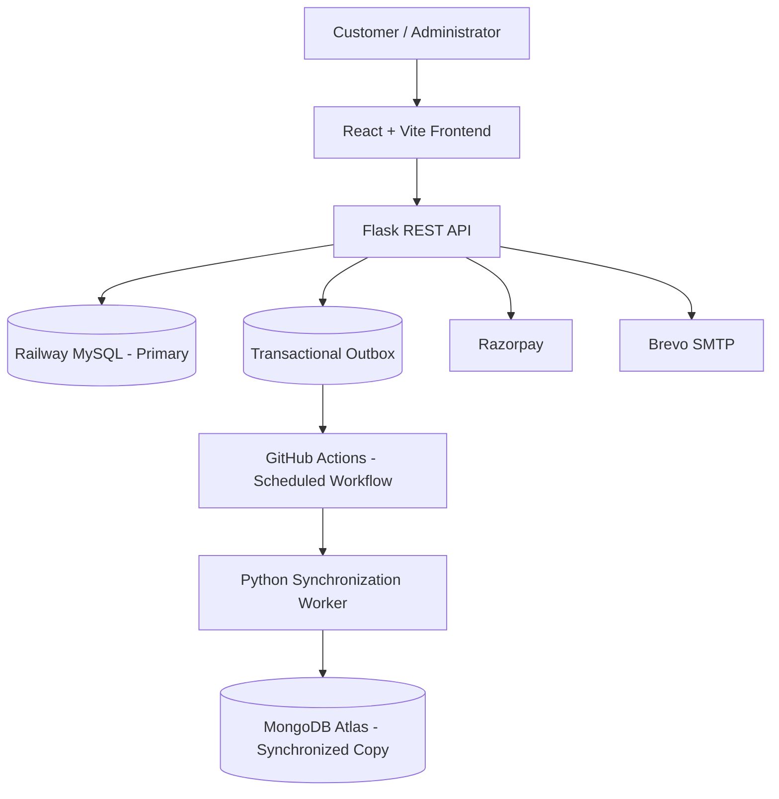

### Architecture Components

**Presentation Layer – React + Vite**

Provides the user interface for customers and administrators. It handles user interactions, navigation, search, cart operations and API communication.

**Application Layer – Flask**

Handles API requests, authentication, business logic, database operations, order processing, payment verification and synchronization-event creation.

**Primary Data Layer – Railway MySQL**

Stores customer information, restaurant details, menu items, orders, order items, reviews and synchronization events. MySQL is the source of truth.

**Secondary Data Layer – MongoDB Atlas**

Stores synchronized document-oriented copies of the application records. MongoDB is not an independent primary write database.

## 5. Application Workflow

### Customer Workflow

1. The customer registers or logs in.
2. The customer browses restaurants and menus.
3. Food items are added to the cart.
4. Delivery details are entered at checkout.
5. The customer places the order and completes payment, where applicable.
6. The customer views order history and tracks order status.
7. The customer can submit a review for an eligible delivered order.

### Admin Workflow

1. The administrator logs in to the admin panel.
2. The dashboard displays platform statistics.
3. The administrator manages restaurants, menu items and orders.
4. The administrator updates order statuses.
5. The administrator checks database connection and synchronization status.

### Order Processing Workflow

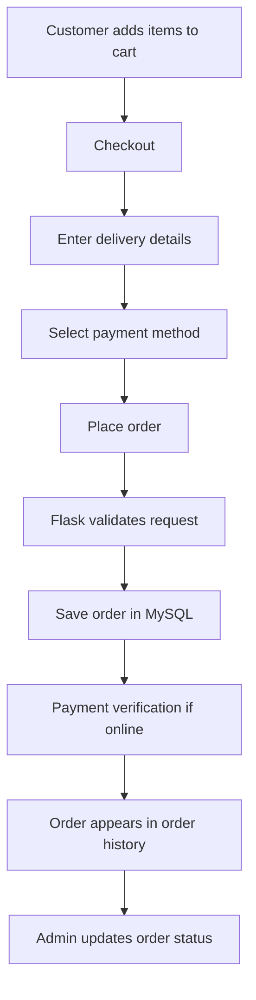

## 6. Database Design

CraveLane uses Railway MySQL as its primary relational database. MongoDB Atlas stores a synchronized document-oriented representation of the data.

### Main MySQL Tables

| Table | Purpose |
|---|---|
| `customer` | Stores customer account and profile details |
| `restaurant` | Stores restaurant information |
| `menu` | Stores restaurant menu items |
| `orders` | Stores customer order information |
| `order_item` | Stores individual items belonging to an order |
| `review` | Stores restaurant ratings and customer reviews |
| `sync_outbox` | Stores events awaiting synchronization to MongoDB |

### Entity Relationship Overview

The principal relationships are:

- One customer can place multiple orders.
- One restaurant can have multiple menu items.
- One order can contain multiple order items.
- Each order item refers to a menu item.
- Reviews are associated with customers, restaurants and orders.

The actual database schema and constraints are defined by the SQL table definitions.

## 7. Project Structure

The following is an overview of the main project files. Additional components and styles may exist in the repository.

```text
CraveLane/
│
├── .github/
│   └── workflows/
│       └── mongo-sync.yml
│
├── backend/
│   ├── app.py
│   ├── requirements.txt
│   ├── .env
│   │
│   ├── database/
│   │   ├── __init__.py
│   │   ├── mysql_db.py
│   │   ├── mongodb.py
│   │   └── sync_outbox.py
│   │
│   └── scripts/
│       ├── migrate_mysql_to_mongo.py
│       └── mongo_sync_worker.py
│
├── frontend/
│   ├── public/
│   ├── src/
│   │   ├── components/
│   │   │   ├── Navbar.jsx
│   │   │   ├── LandingPage.jsx
│   │   │   ├── Login.jsx
│   │   │   ├── Register.jsx
│   │   │   └── RestaurantReviews.jsx
│   │   │
│   │   ├── pages/
│   │   │   ├── RestaurantsPage.jsx
│   │   │   ├── MenuPage.jsx
│   │   │   ├── CartPage.jsx
│   │   │   ├── WishlistPage.jsx
│   │   │   └── AboutPage.jsx
│   │   │
│   │   ├── App.jsx
│   │   ├── main.jsx
│   │   ├── config.js
│   │   └── index.css
│   │
│   ├── index.html
│   ├── package.json
│   └── vercel.json
│
├── screenshots/
│   ├── home.png
│   ├── restaurants.png
│   ├── menu.png
│   ├── cart.png
│   ├── checkout.png
│   ├── orders.png
│   ├── wishlist.png
│   ├── reviews.png
│   ├── admin-dashboard.png
│   ├── order-management.png
│   └── restaurant-management.png
│
└── README.md
```

**Note:** `.env` is a local configuration file and must not be committed to the repository.

## 8. Getting Started

Follow these steps to run CraveLane locally.

### Prerequisites

Install the following:

- Python 3.10 or later
- Node.js and npm
- MySQL Server
- Git
- Visual Studio Code (recommended)

### Step 1: Clone the Repository

```bash
git clone https://github.com/Abinayaa1006/CraveLane.git
cd CraveLane
```

### Step 2: Set Up the Backend

Navigate to the backend directory:

```bash
cd backend
```

Create and activate a virtual environment:

```bash
python -m venv venv
```

**Windows:**

```bash
venv\Scripts\activate
```

Install dependencies:

```bash
pip install -r requirements.txt
```

Create a `.env` file inside the `backend` directory and configure the local database credentials and required service settings.

Start the Flask server:

```bash
python app.py
```

The backend will run at:

```text
http://127.0.0.1:5000
```

### Step 3: Set Up the Frontend

Open another terminal and navigate to the frontend directory from the repository root:

```bash
cd frontend
```

Install dependencies:

```bash
npm install
```

Create `.env.development` inside the `frontend` directory:

```env
VITE_API_URL=http://localhost:5000
```

Start the Vite development server:

```bash
npm run dev
```

Open:

```text
http://localhost:5173
```

### Local database note

For local development, configure the local MySQL database in `backend/.env`. If you want to test MongoDB synchronization locally, also configure `MONGO_URI` and `MONGO_DB_NAME`. The local database must contain the required tables, including `sync_outbox`, and the worker must use the intended database connection.

## 9. Environment Configuration

The application uses environment variables to configure its database connection and external services.

### Backend Environment Variables

Example local configuration:

```env
USE_CLOUD_DB=false

DB_HOST=localhost
DB_PORT=3305
DB_USER=root
DB_PASSWORD=your_mysql_password
DB_NAME=foodorderingdb

CRAVELANE_SECRET_KEY=your_secret_key

RAZORPAY_KEY_ID=your_razorpay_key
RAZORPAY_KEY_SECRET=your_razorpay_secret

MAIL_SERVER=smtp-relay.brevo.com
MAIL_PORT=587
MAIL_USERNAME=your_smtp_username
MAIL_PASSWORD=your_smtp_password
MAIL_DEFAULT_SENDER=your_verified_sender_email

MONGO_URI=your_mongodb_atlas_connection_string
MONGO_DB_NAME=cravelane
```

For cloud deployment, configure the Railway connection values and set:

```env
USE_CLOUD_DB=true
DB_HOST=your_railway_public_hostname
DB_PORT=your_railway_public_port
DB_USER=your_railway_mysql_username
DB_PASSWORD=your_railway_mysql_password
DB_NAME=railway
```

### GitHub Actions Repository Secrets

The GitHub Actions workflow needs the database and MongoDB connection configuration as repository secrets. Use the exact secret names referenced in `.github/workflows/mongo-sync.yml`.

The backend also uses GitHub configuration for the admin-triggered workflow dispatch:

```env
GITHUB_ACTIONS_TOKEN=your_github_token
GITHUB_REPOSITORY=Abinayaa1006/CraveLane
GITHUB_SYNC_WORKFLOW=mongo-sync.yml
GITHUB_SYNC_BRANCH=main
```

The GitHub token must have the permissions required to dispatch the workflow in the repository. Keep it on the backend only.

### Frontend Environment Variables

**Local development:**

```env
VITE_API_URL=http://localhost:5000
```

**Production:**

```env
VITE_API_URL=https://cravelane-backend-m8tn.onrender.com
```

Use the actual values configured for your environment. Never commit `.env` files, passwords, connection strings, Razorpay secrets or GitHub tokens to GitHub. Do not put private credentials in variables prefixed with `VITE_`, because frontend variables are exposed to the browser.

## 10. API Overview

The Flask backend exposes REST API endpoints for the application's operations.

| Endpoint | Method | Purpose |
|---|---|---|
| `/register` | POST | Register a customer |
| `/login` | POST | Authenticate a customer |
| `/restaurants` | GET | Retrieve restaurants |
| `/restaurants/<id>/menu` | GET | Retrieve restaurant menu |
| `/profile/<id>` | GET | Retrieve customer profile |
| `/orders` | POST | Create an order |
| `/my-reviews` | GET | Retrieve customer reviews |
| `/reviews` | POST | Submit a review |
| `/restaurants/<id>/reviews` | GET | Retrieve restaurant reviews |

The backend also contains administrative endpoints for restaurant, menu, order, customer and database-monitoring operations. Authentication, request payloads and response structures vary by endpoint. Refer to the Flask implementation for the complete API contract.

## 11. Deployment

CraveLane is deployed using cloud hosting services.

| Component | Platform |
|---|---|
| Frontend | Vercel |
| Backend | Render |
| Primary MySQL database | Railway |
| Secondary MongoDB database | MongoDB Atlas |
| Synchronization automation | GitHub Actions |
| Payment gateway | Razorpay Test Mode |
| Email service | Brevo SMTP |

The frontend communicates with the Flask backend through HTTP API requests. The backend connects to Railway MySQL using environment variables. GitHub Actions runs the synchronization worker on its configured schedule.

### Deployment configuration

- **Vercel:** Hosts the React + Vite frontend.
- **Render:** Hosts the Flask backend.
- **Railway:** Hosts the primary MySQL database.
- **MongoDB Atlas:** Hosts the synchronized document database.
- **GitHub Actions:** Runs the scheduled MongoDB synchronization workflow.

---

## 12. Future Enhancements

The following improvements are planned or under consideration:

- Real-time or lower-latency database synchronization.
- Automated data reconciliation and field-level comparison.
- Notifications for failed synchronization events.
- More detailed audit logs and synchronization metrics.
- Order tracking improvements.
- Advanced sales, restaurant and customer analytics.
- Personalized food recommendation systems.
- Performance optimization and improved recovery monitoring.

## 13. Project Information and License

**Project:** CraveLane – Online Food Ordering System

Developed as a full-stack academic software project.

**Technologies:** React, Vite, JavaScript, Python, Flask, MySQL, MongoDB, Railway, Render, Vercel, GitHub Actions and Razorpay.

This project is developed for academic and learning purposes. Add an appropriate open-source license before permitting reuse or redistribution.

---

## 14. Application Screenshots

The screenshots below are arranged in the customer journey first, followed by the administrator interface.

### 14.1 Home Page

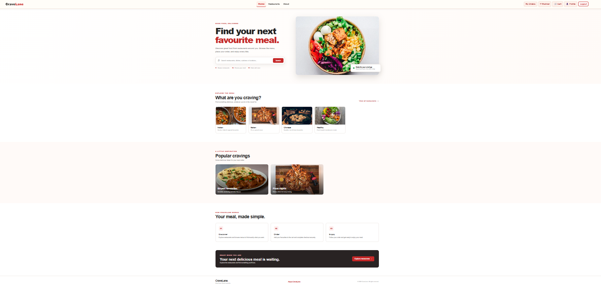

### 14.2 Restaurant Listings

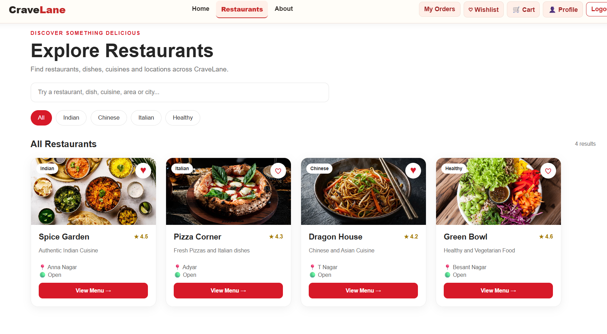

### 14.3 Restaurant Menu

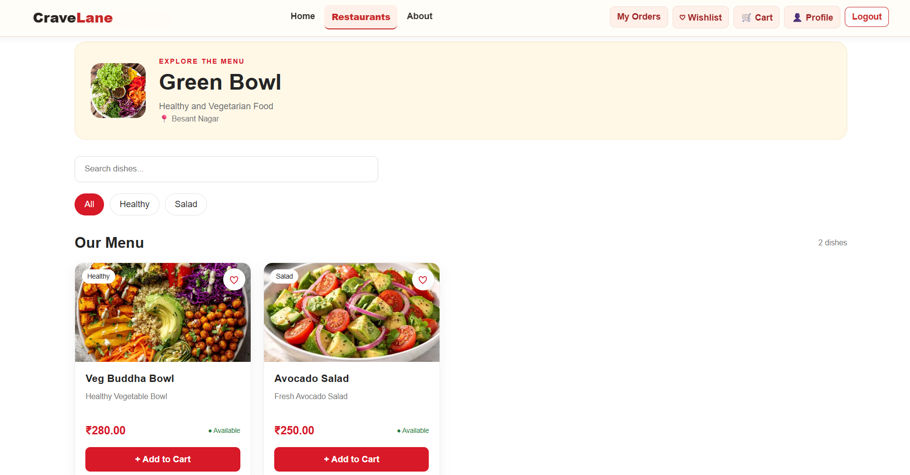

### 14.4 Shopping Cart

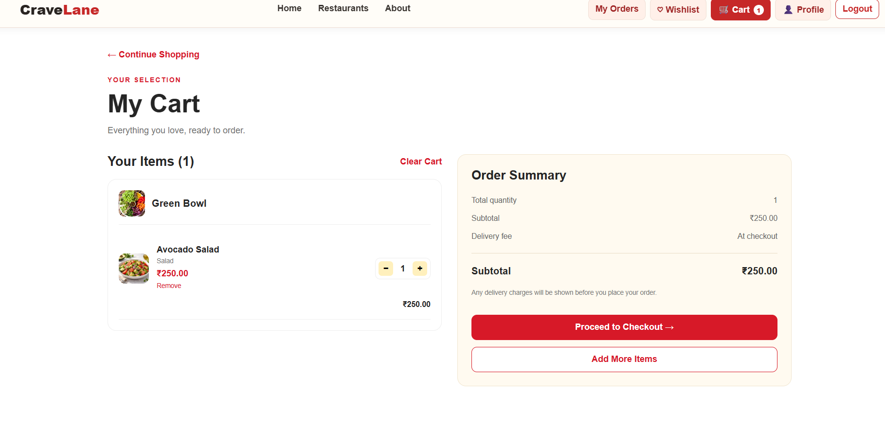

### 14.5 Checkout

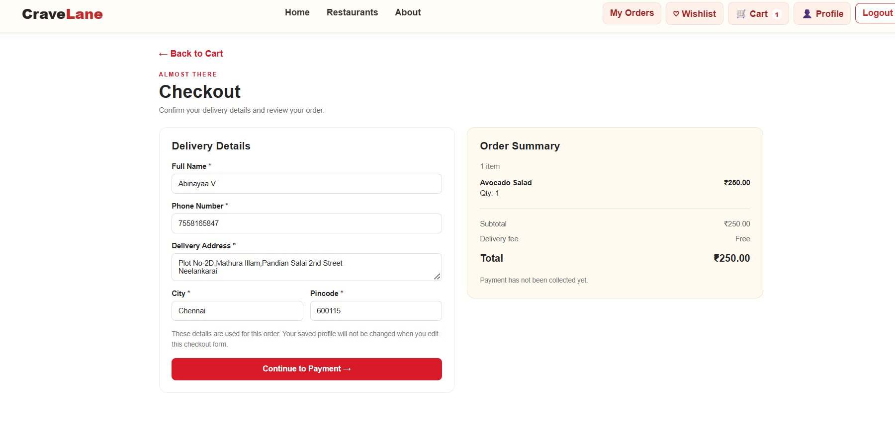

### 14.6 Order History

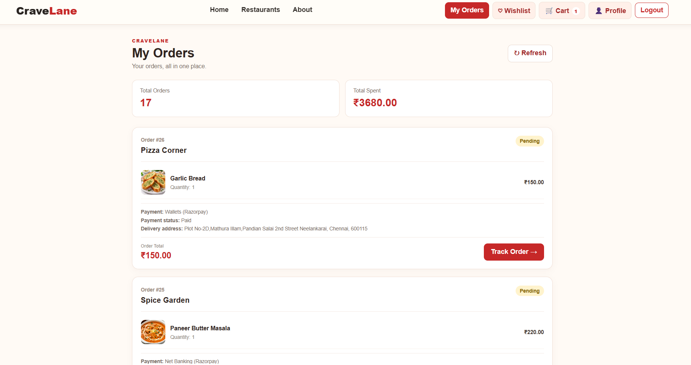

### 14.7 Wishlist

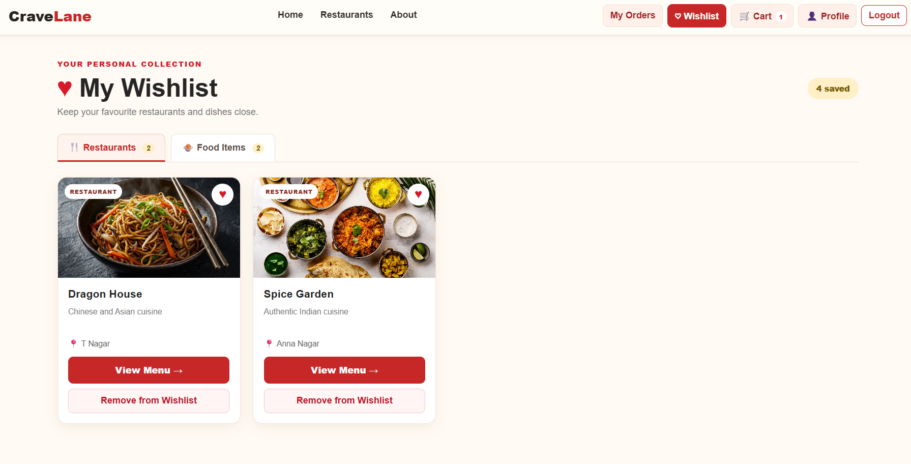

### 14.8 Ratings and Reviews

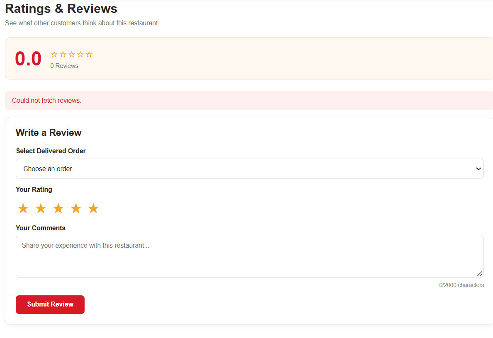

### 14.9 Admin Dashboard

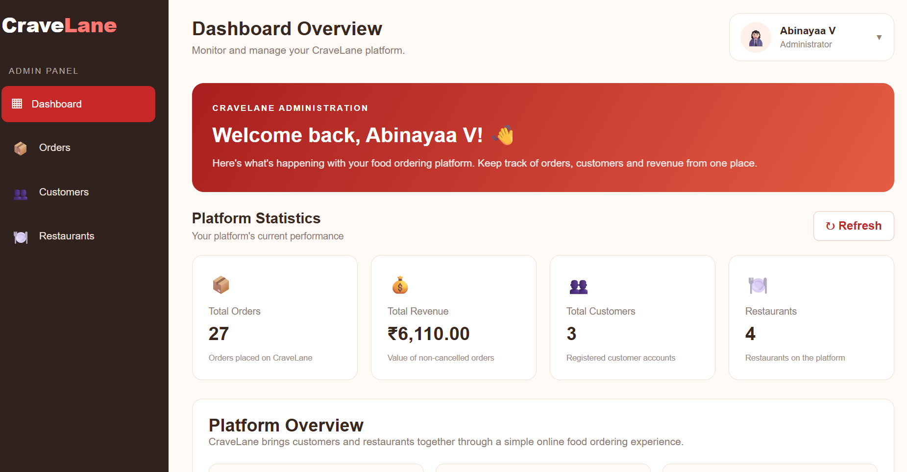

### 14.10 Order Management

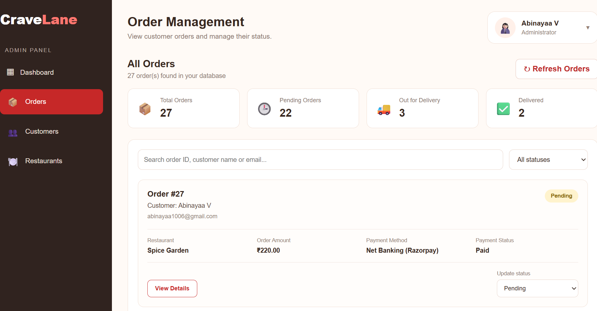

### 14.11 Restaurant Management

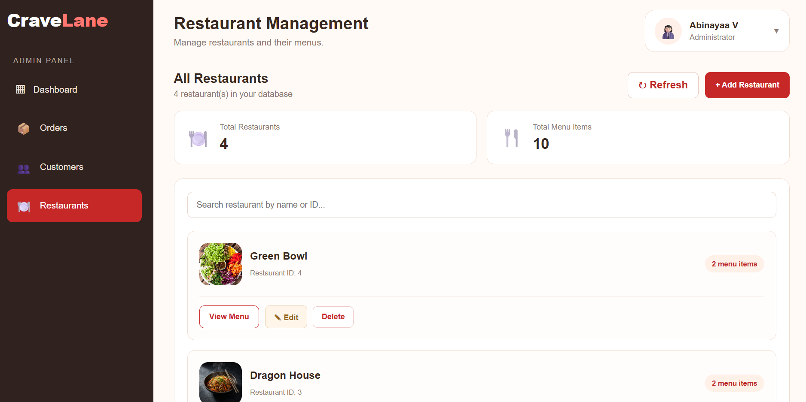

---

## 15. Dual-Database Architecture

CraveLane uses a dual-database architecture in which **MySQL remains the primary database and MongoDB Atlas maintains a synchronized document-oriented copy**.

### Roles of the databases

**MySQL – Primary database**

- Acts as the source of truth for application transactions.
- Stores customers, restaurants, menu items, orders, order items, reviews and synchronization events.
- Enforces relational constraints and relationships.
- Receives application writes first.

**MongoDB Atlas – Secondary database**

- Stores synchronized copies in document collections.
- Uses document structures suited to MongoDB queries.
- Stores order items embedded within their corresponding order documents.
- Does not replace MySQL as the application's primary write database.

**Important:** The current design is one-way synchronization from MySQL to MongoDB. It is not active-active, bidirectional replication, or a mechanism that writes to both databases at exactly the same instant.

## 16. Transactional Outbox and Automatic Synchronization

CraveLane uses the **Transactional Outbox Pattern** to record database changes that need to be reflected in MongoDB.

### Why the Outbox Pattern?

Writing to MySQL and MongoDB independently can create partial updates. For example, the MySQL update might succeed while the MongoDB update fails.

The outbox pattern records the business-data change and its synchronization event in the same MySQL transaction. The MongoDB update is then performed asynchronously by a separate worker.

### Synchronization flow

1. A customer or administrator performs an operation through the application.
2. Flask validates the request and updates the relevant MySQL record.
3. Flask inserts a corresponding event into `sync_outbox` in the same MySQL transaction.
4. The MySQL transaction commits.
5. GitHub Actions starts the Python synchronization worker on its configured schedule.
6. The worker claims pending events from `sync_outbox`.
7. The worker reads the latest corresponding MySQL record and prepares a MongoDB document.
8. The worker performs an upsert or delete operation in the relevant MongoDB collection.
9. After successful synchronization, the event is marked `processed`.
10. If synchronization fails, the worker applies its retry policy and records the error/status.

### Automatic schedule

The GitHub Actions workflow is configured to run every 15 minutes and also supports manual execution:

```yaml
on:
  schedule:
    - cron: "*/15 * * * *"
  workflow_dispatch:
```

- `schedule` requests an automatic run every 15 minutes.
- `workflow_dispatch` allows an administrator or developer to start a run manually when needed.
- Manual execution is optional; normal synchronization is scheduled.
- GitHub may delay scheduled workflows, so the interval is a target schedule rather than a hard real-time guarantee.

### Event status meanings

| Status | Meaning |
|---|---|
| `pending` | Waiting to be synchronized |
| `processing` | Claimed by the worker and currently being processed |
| `processed` | Successfully synchronized to MongoDB |
| `failed` | Retry limit reached without successful synchronization |

### Outbox table

The `sync_outbox` table tracks:

- `Event_ID` – unique event identifier.
- `Entity_Type` – type of record, such as customer, restaurant, menu, orders or review.
- `Entity_ID` – identifier of the affected record.
- `Operation` – `upsert` or `delete`.
- `Status` – current processing status.
- `Created_At` – event creation timestamp.
- `Processed_At` – successful processing timestamp.
- `Attempts` – number of processing attempts.
- `Last_Error` – most recent recorded error, if any.
- `Locked_At` – time at which an event was claimed for processing.

### Synchronization consistency

The application follows **eventual consistency**:

- MySQL is updated first.
- MongoDB is updated after the worker processes the outbox event.
- A short delay between the two databases is expected.
- If an event is pending or being retried, the MongoDB copy may temporarily be behind MySQL.

This is periodic asynchronous synchronization, not instantaneous or synchronous replication.

## 17. MySQL-to-MongoDB Collection Mapping

| MySQL table(s) | MongoDB collection | Document representation |
|---|---|---|
| `customer` | `customers` | One document per customer |
| `restaurant` | `restaurants` | One document per restaurant |
| `menu` | `menu_items` | One document per menu item |
| `orders` + `order_item` | `orders` | One order document with embedded `items` |
| `review` | `reviews` | One document per review |

### Document identifiers and data handling

- Existing MySQL record identifiers are preserved in MongoDB documents.
- The migration and synchronization processes use stable identifiers to support repeatable upserts.
- Order items are embedded in the matching order document.
- Decimal-valued fields are converted to BSON `Decimal128` where appropriate.
- Customer password fields are excluded from MongoDB documents.
- The migration uses replacement/upsert behavior so that rerunning it updates matching documents rather than creating duplicate documents for the same identifier.

## 18. Initial Data Migration

The initial migration was performed using:

```bash
python -m scripts.migrate_mysql_to_mongo
```

The script supports a preview/dry-run mode. To apply the migration:

```bash
python -m scripts.migrate_mysql_to_mongo --apply
```

The successful initial migration reported:

| Entity | MySQL records | MongoDB documents |
|---|---:|---:|
| Customers | 4 | 4 |
| Restaurants | 4 | 4 |
| Menu items | 10 | 10 |
| Orders | 28 | 28 |
| Reviews | 0 | 0 |
| **Total top-level documents** | **46** | **46** |

The 29 `order_item` records were embedded within the 28 order documents. They are not counted as separate top-level MongoDB documents.

These figures represent the initial migration snapshot. Current counts can change as customers, restaurants, menu items, orders and reviews are added, modified or deleted.

## 19. Admin Database and Synchronization Monitoring

The administrator dashboard includes a database monitoring section.

### Monitoring capabilities

- MySQL connection status.
- MongoDB connection status.
- Database selector to inspect MySQL or MongoDB record counts.
- Counts for customers, restaurants, menu items, orders and reviews.
- Synchronization queue counts for pending, processing, processed and failed events.
- Recent synchronization event history.
- Manual GitHub Actions workflow trigger.

### Manual trigger and automatic execution

The manual trigger is provided for administrative testing or immediate synchronization requests. It is not required for routine synchronization because the GitHub Actions schedule runs automatically.

The Flask backend sends the GitHub workflow-dispatch request. The GitHub token is stored as a backend environment variable and is not placed in frontend code.

A successful dispatch response means GitHub accepted the workflow request. The workflow run itself must still complete successfully for the events to be confirmed as synchronized.

## 20. Verifying Database Synchronization

The following checks can be used to verify the current state of both databases.

### MySQL record counts

Run in MySQL Workbench:

```sql
SELECT 'customers' AS entity, COUNT(*) AS total FROM customer
UNION ALL
SELECT 'restaurants', COUNT(*) FROM restaurant
UNION ALL
SELECT 'menu_items', COUNT(*) FROM menu
UNION ALL
SELECT 'orders', COUNT(*) FROM orders
UNION ALL
SELECT 'reviews', COUNT(*) FROM review;
```

### MySQL outbox status counts

```sql
SELECT Status, COUNT(*) AS total
FROM sync_outbox
GROUP BY Status;
```

For a caught-up queue, there should be no pending or processing events. A new event may temporarily appear as pending or processing while a scheduled run is underway. Investigate any events marked `failed`.

### Recent synchronization events

```sql
SELECT
    Event_ID,
    Entity_Type,
    Entity_ID,
    Operation,
    Status,
    Attempts,
    Created_At,
    Processed_At,
    Last_Error
FROM sync_outbox
ORDER BY Event_ID DESC
LIMIT 20;
```

### MongoDB collection counts

Run in MongoDB Atlas Data Explorer or a MongoDB shell, after selecting the `cravelane` database:

```javascript
db.customers.countDocuments({})
db.restaurants.countDocuments({})
db.menu_items.countDocuments({})
db.orders.countDocuments({})
db.reviews.countDocuments({})
```

### What constitutes a successful verification?

1. Compare the corresponding MySQL and MongoDB counts.
2. Compare individual documents using their preserved record identifiers.
3. Inspect important fields such as customer details, restaurant addresses, menu prices and order statuses.
4. Confirm that the relevant outbox events are marked `processed`.
5. Check that `Last_Error` is empty for successfully processed events.

Matching record counts alone do not prove that every field is identical. Individual record checks provide stronger verification.

**Important:** Changes made directly in MySQL Workbench do not automatically create outbox events. Normal application changes must pass through the Flask operations that enqueue synchronization events, or an appropriate event must be created separately.

## 21. Updated Deployment Architecture

| Component | Platform | Responsibility |
|---|---|---|
| React frontend | Vercel | Customer and administrator interface |
| Flask backend | Render | REST APIs and application logic |
| Primary database | Railway MySQL | Source of truth and outbox |
| Secondary database | MongoDB Atlas | Synchronized document copy |
| Synchronization automation | GitHub Actions | Scheduled worker execution |
| Payment gateway | Razorpay Test Mode | Payment processing |
| Email service | Brevo SMTP | Email delivery |

### GitHub Actions configuration

The repository workflow is located at:

```text
.github/
└── workflows/
    └── mongo-sync.yml
```

The workflow uses repository secrets for database and MongoDB connection configuration. The backend uses environment variables for the GitHub workflow-dispatch token and repository configuration.

Never commit `.env` files, database passwords, MongoDB connection strings or GitHub access tokens.

## 22. Testing and Verification

The following integration checks have been performed during development:

1. Initial Railway MySQL-to-MongoDB Atlas migration.
2. MongoDB Atlas connectivity from the local environment.
3. Restaurant description update synchronization.
4. Restaurant address update synchronization.
5. MySQL transactional outbox event generation.
6. Successful event processing and status updates.
7. GitHub Actions manual workflow execution.
8. GitHub Actions workflow dispatch through the administrator dashboard.
9. Admin database monitoring and record-count display.
10. Successful GitHub Actions workflow runs after manual dispatch from the admin dashboard.

The tested restaurant updates appeared in MongoDB Atlas, and corresponding outbox events were marked `processed`.

**Testing scope note:** These checks confirm the initial migration and the tested restaurant synchronization flows. Each other entity and operation (customer, menu, order, review and deletion) should also be tested before claiming complete end-to-end coverage for every application operation.

## 23. Security and Operational Considerations

- MySQL remains the primary source of truth.
- MongoDB is a secondary synchronized copy, not a second independent write destination.
- Customer passwords are excluded from the MongoDB synchronization documents.
- Database credentials and API tokens are stored in environment variables or hosting secrets.
- The GitHub Actions token is used by the Flask backend for workflow dispatch and must never be exposed to the React frontend.
- Admin monitoring and trigger endpoints must remain protected by administrator authentication.
- Failed events should be monitored and investigated.
- Scheduled GitHub Actions execution is subject to GitHub's scheduling availability and possible delays.
- The synchronization worker should be monitored so that stale processing events and repeated failures can be investigated.
